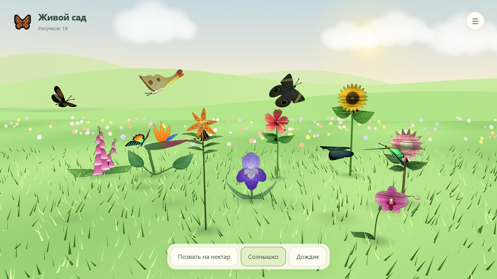

**English** · [Русский](README.ru.md)

# Paper Aquarium

A home game for a child, in the spirit of teamLab's *Sketch Aquarium*: print
a sheet, colour it with markers, take a photo with a phone — and the fish
starts swimming in an aquarium on the big screen.

```
A4 colouring sheet  →  phone photo  →  texture  →  3D fish in the scene
```

The server is plain Node with zero dependencies, the scene is three.js, and
everything the game owns lives in `data/`.

Questions, ideas and "it won't start for me" — the project chat:
[t.me/+5PkSBR1C6LtmOTM0](https://t.me/+5PkSBR1C6LtmOTM0).


| | |
|---|---|
|  |  |
| Tap anywhere — a menu with every road out | The sheet is photographed right there, in a frame |
|  |  |
| Twelve A4 sheets with markers in the corners | Ready-made fish, when there is no time to colour |

More: [the list of fish with their drawings](docs/screenshots/fish-list.jpg),
[choosing a background](docs/screenshots/backgrounds.jpg),
[the list of aquariums](docs/screenshots/home.jpg).

## How it works

**The colouring sheet.** Four black 6×6 markers in the corners: their 16 inner
cells encode the species and the corner number. The capture step uses them to
find the sheet in a photo and undo the perspective — the markers must stay
uncoloured, everything else is fair game. The fish outline is printed as a thin
grey line and the fin areas as a pale dashed one, so they are visible without
the child taking the hint for part of the drawing.

**Capture.** `assets/capture.js` looks for the markers by sweeping brightness
thresholds, undoes the perspective, cuts the drawing along the species contour
from the manifest and trims a strip along the printed line itself — otherwise
it would stay as a dark rim on the fish. The result is a texture, mapped onto
the 3D model through a planar unwrap of its side silhouette.

**The aquarium.** `demos/realistic-tank.html`: the fish swim inside a volume
that follows the camera frustum rather than a box — against a box, fish near
the far wall would huddle towards the centre of the screen. The scene works out
the model's orientation (where the nose is, where the back is) on its own, from
the tail beats in the animation: `assets/fish-frame.js`.

**The menu.** A tap anywhere in the aquarium opens the menu: capture, ready-made
fish from the pack, food, colouring sheets, background, removing fish and
“Open on another screen” — a QR code, a link and a five-digit TV code.
Capture, background and sheets open right there in a frame — they are the
same pages (`?embed=1`), not copies of them.

**The showcase.** The `AQUA_DEMO_TANK` variable turns one aquarium into
a public showcase: the home page offers newcomers a “Peek at a live
aquarium” card, and a `?demo` link opens it with a trimmed menu — feed the
fish or start your own. A screen opened with a PIN (`?tv`) never pops the
menu by itself: that screen is for watching, the phone is for driving.

**Languages.** Russian, English and Polish; on the first visit the device
language is used, after that whatever the switcher was set to. All strings live
in `assets/i18n.js` and the markup is annotated with `data-t` attributes. The
colouring sheets are trilingual too: the caption under the fish is printed in
the language of the page, while the corner markers are identical in every
version — any printed sheet is recognised.

## Living garden



Choose **New garden** on the home page or **Living garden** in the aquarium
menu. Colour the butterfly and flower sheets, photograph them, and watch
butterflies visit your flowers. Nectar calls them over; sunshine and rain
sync across open screens. Ready-made drawings let you try it without printing.

Switching worlds keeps both fish and garden drawings. The drawings page only
removes items from its own world, into the existing bin. The 40-item limit is
shared. The garden also works offline on Android TV: its lightweight Canvas
scene runs in a WebView while the aquarium keeps its native Filament renderer.
No purchased models are needed for the garden.

Generate the two A4 sheets in all three languages with `npm run garden`.
Print at `/print.html?world=garden` and check recognition at
`/tools/test-capture.html?world=garden`. Garden marker codes are distinct from
all fish codes; capture, storage and backups use the existing format.

## Running it

```bash
node server.js          # http://localhost:8000
```

Node 18+ is required. There is nothing to install: no dependencies, and
three.js sits in `vendor/`. The port is set by `PORT`.

The server prints the addresses of every network interface — use them to open
the aquarium from a phone or a TV on the same Wi-Fi.

## Access

There are no accounts. Every aquarium has a 10-character code (which is also
its address) and a password:

| | code (the link) | password |
|---|---|---|
| watch the aquarium | ✅ | |
| add a fish, feed them, change the background | ✅ | |
| delete fish or the aquarium, rename it | | ✅ |

Capture and feeding are deliberately password-free: the child opens the link on
a phone, and asking for a password there would kill the whole idea. Nothing can
be spoiled that way — everything irreversible is behind the password.

For a TV there is a shortcut: “Open on another screen” in the aquarium
menu hands out a temporary five-digit code (lives 5 minutes, kept in the
server's memory). It goes into the same field on the home page as the
regular code; guessing is choked by a growing per-address pause.

The code is long on purpose: 31¹⁰ ≈ 8·10¹⁴ combinations, so somebody else's
drawings cannot be found by guessing. A five-digit code (100,000 combinations)
would be brute-forced in minutes. The password is protected by a pause after
five misses, growing to ten minutes.

## Deployment

Everything a server needs sits next to the code: `Dockerfile`,
`docker-compose.prod.yml` and `.env.example`. The aquarium is a single
container with no proxy of its own: HTTPS, the domain and the certificate are
handled by Traefik through the external `web` network. The order of steps,
backups and the usual breakages are in [DEPLOY.md](DEPLOY.md) (in Russian).

```bash
cp .env.example .env      # DOMAIN
docker compose -f docker-compose.prod.yml --env-file .env up -d --build
```

The model pack never enters the image — it is mounted from the server as
a volume.

## What to know before putting it on the open internet

- **The password travels in plain text** in the `X-Tank-Pass` header. Inside
  a home network that is acceptable; on the internet HTTPS is mandatory, and
  the proxy provides it. On the server only a salted scrypt hash of the
  password is stored.
- **Adding fish and uploading backgrounds without a password** is a deliberate
  decision: the child opens capture from a link on a phone. So that nobody can
  fill the disk with it, there are limits (all of them environment variables):

  | Variable | Default | What it limits |
  |---|---|---|
  | `AQUA_MAX_TANKS` | 200 | aquariums on the server in total |
  | `AQUA_TANKS_PER_HOUR` | 5 | new aquariums from one address per hour |
  | `AQUA_MAX_FISH` | 40 | fish in a single aquarium |
  | `AQUA_MAX_BG` | 8 | custom backgrounds in a single aquarium |
  | `AQUA_MAX_DATA_MB` | 2048 | the size of the whole `data/` folder |
  | `AQUA_DEMO_TANK` | — | code of a showcase aquarium: the home page offers newcomers a “Peek at a live aquarium” button |

  Plus hard limits per picture: 3 MB for a fish, 6 MB for a background, 12 MB
  for the request body.
- The server only serves what `staticFor()` lists: the pages, `assets/`,
  `vendor/`, `demos/`, `tools/`, and from `data/` — nothing but scene snapshots
  and uploaded backgrounds. Everything else, including `.git` and `server.js`
  itself, gets a 404.

## The fish models: what to buy and where to put it

The fish are not in this repository and cannot be: the game uses a purchased
pack whose licence allows use but forbids redistributing the files. Without the
models everything still starts, but the aquarium stays empty. Four steps get
them swimming — about fifteen minutes including the download.

**1. Buy the pack**

[Coral Reef Fish Collection animated — Game Ready pack 8](https://www.cgtrader.com/3d-model-collections/coral-reef-fish-collection-animated-game-ready-pack-8)
by JosKata, on CGTrader. Thirty reef fish with skeletal animation, Royalty Free
licence.

This exact pack is not strictly required — any fish will do, see "Other models"
below. But the colouring sheets in this repository were traced from it, and
without rebuilding the sheets the species will not match.

**2. Lay out the files**

From the download you only need the **`fbx` folder** — thirty `.fbx` files. The
textures are already embedded in them; the separate `.rar` archives in
`textures/` do not need unpacking (they are only useful if you want to rebuild
the pack at the original resolution).

```
paper-aquarium/
└── купил 3д рыбок/          ← "the 3D fish I bought"
    └── fbx/
        ├── Auriga Butterflyfish.fbx
        ├── Bicolor Angelfish.fbx
        └── … 30 files in total
```

The folder `купил 3д рыбок/` is in `.gitignore` — your purchase stays yours.
The name can be changed, in which case the path is passed to the script:
`-Pack "your\folder"`.

**3. Convert to glTF**

You will need the FBX2glTF converter (Windows, PowerShell):

```powershell
npm install --no-save fbx2gltf

# the path inside the package depends on the version — let PowerShell find it
$env:FBX2GLTF = (Get-ChildItem node_modules -Recurse -Filter FBX2glTF.exe)[0].FullName

powershell -ExecutionPolicy Bypass -File tools\convert-pack.ps1
```

The script unpacks every fish, squeezes the textures down to 1024 px JPEG (the
originals are 2048×2048 PNGs of 3–4 MB each — 110 MB per pack instead of 12),
fixes the alpha channel that makes some fish arrive invisible, and lays out the
result:

```
assets/models/pack/
├── clownfish/
│   ├── clownfish.gltf
│   ├── buffer.bin
│   └── clownfish_basecolor_COLOR.jpg
├── bluetang/
└── … 28 folders + pack.json
```

Twenty-eight, not thirty: two fish in the pack have no embedded textures or
empty geometry, so the script drops them and says so in the console.

**4. Check**

```bash
node server.js
```

Open `http://localhost:8000`, create an aquarium, tap it and choose
"🐠 Release a ready-made fish" — you should see 12 cards with thumbnails.
Twelve, not twenty-eight: only species that have a colouring sheet make it into
the picker — what can be coloured is what swims. The full list of converted
models is served by `http://localhost:8000/api/pack` (28 there, with
`sheet: true` on the species that have a sheet). Empty means the pack was not
built — look for "пропуск" ("skipped") lines in the script's output.

### Other models

The script is tailored to this pack and to Windows (it resizes textures with
System.Drawing). Any `.glb`/`.gltf` files of your own go into
`assets/models/pack/` by hand — one folder per species, with a `pack.json`
listing them next to it.

The species in the game are defined by `assets/coloring/manifest.json`, which is
built from the silhouettes of the models. So a different set of fish means the
sheets have to be rebuilt: `/tools/silhouettes.html` → `node
tools/make-coloring.js`. Model requirements, how to add a species and the
conversion pitfalls are in
[assets/models/README.md](assets/models/README.md) (in Russian).

## TV app: the aquarium without internet

`android/` is the same aquarium as an Android TV app. No internet needed: the
TV serves the pages and takes the fish itself, and a phone on the same Wi-Fi
opens the aquarium from the QR code on screen — capture, ready-made fish,
feeding and backgrounds work as on the site. Why this rather than a separate
phone app: [docs/adr/0001](docs/adr/0001-tv-hub-webview.md).

The TV scene is native, on Filament: the site scene in a WebView ran at 5 fps
on a weak TV, the native one runs at 30 with 40 fish and looks the same
([docs/adr/0002](docs/adr/0002-native-filament-on-tv.md)). Needs Android 7+
with OpenGL ES 3.0.

To install a GitHub release, see the
[illustrated Android TV guide (Russian)](docs/android-tv-install.md).

**Building.** You need the Android SDK and JDK 17+; Android Studio is
optional. The model pack must be in `assets/models/pack/` (see above) — the
APK takes it and the web part straight from the repository. Sign with a
permanent key: an APK signed differently will not install over the old one,
and reinstalling wipes the drawings on the TV. The key password goes into
`~/.gradle/gradle.properties`:

```properties
aquaStorePassword=…
aquaKeystore=path/to/release.p12
```

```bash
cd android
./gradlew assembleRelease
adb connect <TV address>
adb install -r build/outputs/apk/release/paper-aquarium-tv-release.apk
```

Without the purchased pack, the test one will do for a check:
`node tools/make-test-pack.js` and
`node tools/make-test-pack.js --out pack-lod1 --grid 24` (far LOD).

For signed GitHub releases, see [the release guide](docs/release.md).

**Remote.** OK shows the QR code and address for the phone, Back hides it or
exits. An empty aquarium shows the QR code by itself. The aquarium only takes
fish while it is open; meanwhile the capture page on the phone offers
"Send again".

**What the TV does not have.** One aquarium, no code, password or PIN: the
network is a home one, and deleted fish go to the trash. No custom
backgrounds — built-in ones only.

**Backup.** adb cannot reach the app data on Android 14, so the backup is a
zip over HTTP, with all drawings and the trash:

```bash
curl -o aquarium.zip http://<TV address>:8000/backup.zip
```

To restore, send the same archive back; the previous folder stays on the TV
next to it (`tank.prev`):

```bash
curl --data-binary @aquarium.zip -H "Content-Type: application/zip" http://<TV address>:8000/backup.zip
```

When the app is uninstalled, Android asks whether to keep its data.

## Tools

| What | Where | Why |
|---|---|---|
| Silhouettes | `/tools/silhouettes.html` | traces the pack models, produces `contours.json` and the fins drawn over the body |
| Sheets | `node tools/make-coloring.js` | builds 12 A4 sheets in three languages, pages with 4 and 6 fish per A4, and the manifest |
| PDF | `node tools/make-pdf.js` | prints the sheets into `raskraski.<lang>.pdf` (and `raskraski-4/-6.<lang>.pdf` with 4 or 6 fish per page) via headless Chrome; run after make-coloring |
| Capture test | `/tools/test-capture.html` | runs every sheet through skew, rotation and noise |
| Pack build | `tools/convert-pack.ps1` | FBX from the purchased archive → glTF |
| Test pack | `node tools/make-test-pack.js` | fish from the `contours.json` silhouettes without buying anything — for measurements and checks; `--fill <code> N` fills an aquarium |

After the sheets change, the capture test must report no failures: the markers
are chosen so that the codes of any two species differ in at least four cells.

## Data

Everything lives in `data/tanks/<code>/`: `meta.json` (name, salt and password
hash), `settings.json` (background), `fish/` (drawings and their descriptions),
`backgrounds/` (uploaded backgrounds), `preview.jpg` (the snapshot for the
card). Deleted things move to `trash/` and `data/trash-tanks/` instead of being
erased: there are children's drawings inside.

Deleted items stay in the trash for 30 days (`AQUA_TRASH_DAYS`) and are then
erased for good: a child deletes a drawing by accident and it has to be
recoverable, but an eternal trash bin on a public server is a warehouse of
other people's children's drawings that they believe are deleted.

The `data/` folder is not part of the repository — it is one family's data.
A backup of the game is a copy of that folder.

For a public server there is a [Terms and data](terms.html) page
(`/terms.html`): what is stored, how long it lives, how to get it deleted, GDPR
rights and a contact. The server itself keeps no access log: it only writes
"a fish was added to such and such aquarium", with no addresses. Check what the
proxy in front of it writes — either turn its access log off, or leave the terms
text as it is (it already says that the proxy keeps such a log). Details are
under "Журнал обращений" in [DEPLOY.md](DEPLOY.md).

## Licence

The code is [MIT](LICENSE). The aquarium backgrounds in `assets/backgrounds/`
were made by the author of the project and come under the same terms.

The fish models are not covered by the project licence: the pack is bought
separately and is not part of the repository. The silhouettes in
`assets/coloring/*.svg`, `tools/contours.json` and
`assets/coloring/manifest.json` were traced from the pack models — they are
derived 2D contours, not the models themselves, and for a different set of fish
they are rebuilt from scratch.
