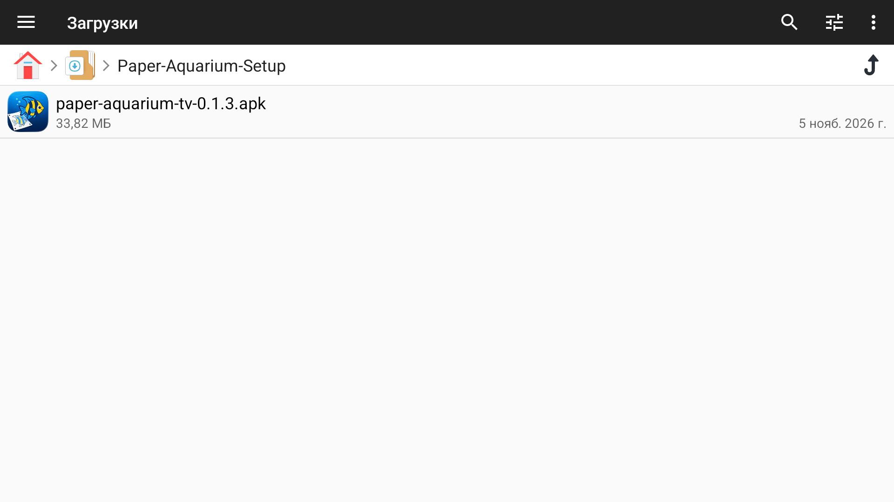
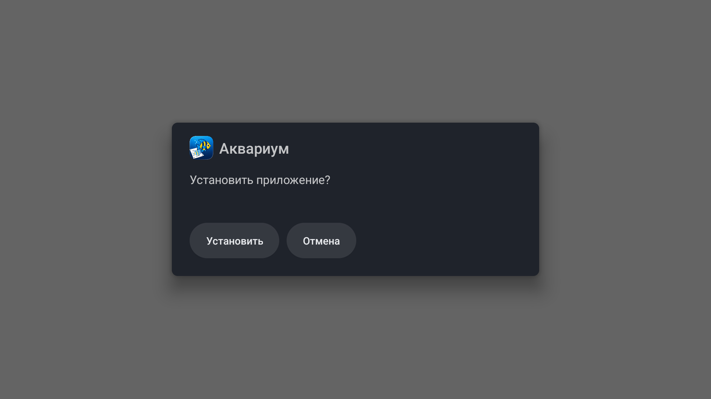
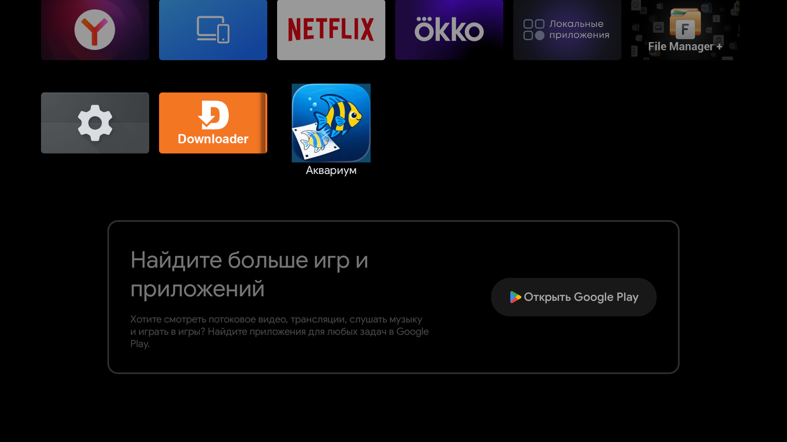
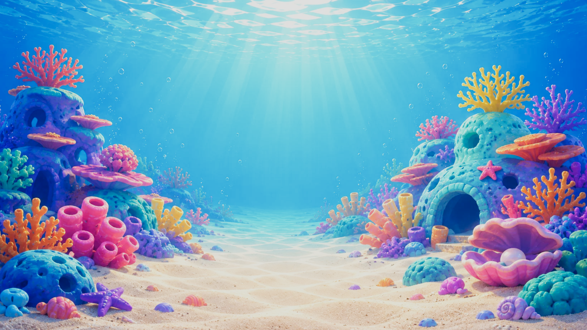

# Установка Paper Aquarium на Android TV

На телевизоре приложение называется **«Аквариум»**. Нужен Android TV с Android 7 или новее и OpenGL ES 3.0. Для отправки рисунков телефон и телевизор должны быть в одной домашней сети.

## 1. Скачайте APK

Откройте [последний релиз на GitHub](https://github.com/Arenoros/paper-aquarium/releases/latest). В разделе **Assets** скачайте файл `paper-aquarium-tv-<версия>.apk`. Один файл подходит для 32- и 64-битных ARM-телевизоров.

## 2. Установите приложение с пульта

1. Скопируйте APK на USB-флешку и вставьте её в телевизор. Если APK уже скачан на телевизор, найдите его в папке **Загрузки**.
2. Откройте файловый менеджер на ТВ, выберите флешку или папку **Загрузки**, затем выделите APK и нажмите **OK**. На скриншотах показан Haier с Android TV 14 и файловым менеджером File Manager+.

   

3. Если файловый менеджер покажет карточку APK, выберите в ней **Установить**. Если Android попросит разрешение, откройте **Настройки** из системного окна и разрешите установку из этого источника для файлового менеджера. Вернитесь к APK и откройте его снова.
4. В системном окне выберите **Установить**. При обновлении версии с той же подписью установщик может показать кнопку **Обновить**. Дождитесь завершения и нажмите **Открыть**, если эта кнопка доступна.

   

Конфликт пакетов возможен при переходе с тестовой или самостоятельно подписанной сборки. Если сертификаты отличаются, сначала сохраните [резервную копию аквариума](../README.ru.md#тв-приложение-аквариум-без-интернета). Затем удалите старую сборку, установите APK с GitHub и восстановите данные из архива.

## 3. Откройте «Аквариум»

Нажмите **Домой** на пульте и перейдите в **Приложения**. В списке установленных приложений выберите **Аквариум** и нажмите **OK**. Если появится меню плитки, выберите **Открыть**.



Аквариум откроется на весь экран. Нажмите **OK** на пульте, чтобы показать QR-код, затем наведите на него камеру телефона. На телефоне откроется страница этого телевизора. Пустой аквариум показывает QR-код при первом запуске. Кнопка **Назад** закрывает QR-код.



## Установка с компьютера через ADB

Для Android TV 13 и новее с беспроводной отладкой подключите телевизор и компьютер к одной сети. На ТВ включите **Для разработчиков → Беспроводная отладка**. Если меню разработчика скрыто, в разделе **Об устройстве** семь раз нажмите на номер сборки. На компьютере установите [Android SDK Platform-Tools](https://developer.android.com/tools/releases/platform-tools).

На ТВ выберите **Подключить устройство с помощью кода подключения** и подставьте адрес, порт и код с этого экрана. Для `adb connect` возьмите адрес и порт с главного экрана беспроводной отладки. Пример ниже использует условные адреса и APK версии `0.1.3`.

```text
adb pair 192.168.1.50:37123
adb connect 192.168.1.50:39821
adb devices
adb -s 192.168.1.50:39821 install -r paper-aquarium-tv-0.1.3.apk
adb -s 192.168.1.50:39821 shell am start -n info.arenoros.aquarium/.MainActivity
```

В списке `adb devices` телевизор должен иметь статус `device`. Установку подтверждает строка `Success`. Параметр `-r` сохраняет данные при обновлении пакета с той же подписью. Для других способов подключения см. [справку Android по ADB](https://developer.android.com/tools/adb#wireless).

## Следующие обновления

Начиная с `v0.1.3`, сборка с GitHub сама проверяет новые релизы при запуске и каждые шесть часов, пока приложение открыто. Когда появится обновление, разрешите **«Аквариуму»** установку из этого источника, если приложение попросит. Если Android покажет системное подтверждение, нажмите **Обновить**. [Как работает автообновление](release.md#автообновление-на-тв).
